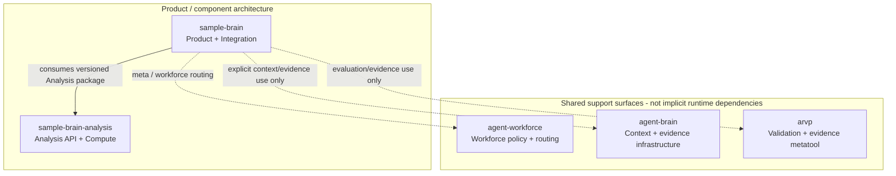

# Repository Ecosystem Navigation

**Status:** ACTIVE_NAVIGATION
**Purpose:** Help humans and agents choose the owning repository and the correct Sample Brain front door without duplicating live state or cross-repository canon.

## Authority rule

This page is a navigation layer, not a new source of product or cross-repository truth.

1. GitHub/repository live state wins for current branches, issues, PRs, checks and code.
2. Inside `sample-brain`, local `AGENTS.md`, canon, contracts and owning issues remain authoritative.
3. The canonical shared meta-layer / metatool classification lives in [`agent-workforce/docs/META_TOPOLOGY.md`](https://github.com/jannekbuengener/agent-workforce/blob/main/docs/META_TOPOLOGY.md).
4. The summaries below only answer where to go next. They do not make another repository authoritative over Sample Brain.

## Quick routing

| Repository | Role from Sample Brain | Leave `sample-brain` when... | Boundary |
|---|---|---|---|
| [`jannekbuengener/sample-brain`](https://github.com/jannekbuengener/sample-brain) | Product/application/integration owner | The work changes Catalog/DB, persistence, product orchestration, Workbench/QML, session/realtime integration, AQ orchestration, consumer adapters or Sample Brain policy/docs | Default owner for Sample Brain work |
| [`jannekbuengener/sample-brain-analysis`](https://github.com/jannekbuengener/sample-brain-analysis) | **Component dependency**: independent deterministic Analysis API / compute package consumed by Sample Brain | The change belongs to package-owned analysis algorithms, public Analysis API/DTO contracts or package-local validation | Does not own Catalog/DB, Product State, Workbench/QML, persistence or Sample Brain orchestration; see [Analysis Package Boundary](ANALYSIS_PACKAGE_BOUNDARY_V1.md) |
| [`jannekbuengener/agent-workforce`](https://github.com/jannekbuengener/agent-workforce) | **Shared meta layer**: workforce identity, authority, routing, portfolio and operating policy | The change is cross-repository workforce policy, role authority, portfolio membership or shared workforce contracts | Not a Sample Brain runtime dependency and cannot override repository-local authority |
| [`jannekbuengener/agent-brain`](https://github.com/jannekbuengener/agent-brain) | **Shared meta layer**: generic knowledge, context, evidence, decision, memory and retrieval infrastructure | The change is generic Agent Brain infrastructure rather than Sample Brain product/context usage | Not an implicit Sample Brain runtime dependency; use only through an explicit authorized integration/routing contract |
| [`jannekbuengener/arvp`](https://github.com/jannekbuengener/arvp) | **Metatool**: domain-neutral deterministic validation, evaluation, gates and evidence | The change belongs to the reusable ARVP validation/evidence framework itself | ARVP evidence can support Sample Brain evaluation but does not own product behavior, CI or release authority; no implicit runtime dependency |

### Routing rule of thumb

```text
START IN sample-brain
    |
    +-- Product / persistence / Workbench / integration / consumer adapter? -> stay in sample-brain
    |
    +-- Analysis package API / DTO / compute semantics? -> sample-brain-analysis
    |
    +-- Cross-repo workforce policy / portfolio / role authority? -> agent-workforce
    |
    +-- Generic context / evidence / memory / retrieval infrastructure? -> agent-brain
    |
    +-- Generic deterministic validation / gate / evidence framework? -> arvp
```

If Sample Brain only **consumes, configures or adapts** another repository's capability, the consumer-side change normally stays in `sample-brain`. Move repositories only when the owning contract says the implementation itself belongs elsewhere.

## Product/component architecture vs shared ecosystem

The product architecture intentionally remains smaller than the surrounding engineering ecosystem:



The solid arrow is a product/component dependency. Dotted arrows are navigation/support relationships only. The [System Map](visuals/system-map.md) and [Ownership Map](visuals/ownership-map.md) deliberately keep shared meta infrastructure out of the product/component diagram.

## Sample Brain front doors

| Question | Start here | Authority note |
|---|---|---|
| What is Sample Brain and how do I run it? | [Root README](../README.md) | Product landing page and quickstart |
| Where is the documentation index? | [Documentation Index](README.md) | Navigation only |
| Which product/system document is authoritative? | [Canon Index](CANON_INDEX.md) | Local authority map; live GitHub/repo state still wins for execution state |
| What is the current product flow? | [Product Workflow Canon](PRODUCT_WORKFLOW_CANON.md) | Product-path authority |
| What are the architecture and component boundaries? | [Target Architecture](TARGET_ARCHITECTURE.md), [Architecture Visuals](visuals/README.md) | Visuals orient; canon/contracts remain authority |
| Who owns Analysis package vs consumer behavior? | [Analysis Package Boundary](ANALYSIS_PACKAGE_BOUNDARY_V1.md), [Analysis Consumer Contract](ANALYSIS_PUBLIC_CONTRACT_V1.md) | Component ownership / consumer boundary |
| Which internal capability or worker route should an agent use? | [Operations / Capabilities](operations/README.md) | Process/routing front door, not product canon |
| What should an agent read at session start? | [SB.BOOTLOADER](../SB.BOOTLOADER.md), [AGENTS](../AGENTS.md) | Session startup and repository-local rules |
| What is the durable orientation snapshot? | [Current Status](../knowledge/CURRENT_STATUS.md), [Active Roadmap](../knowledge/ACTIVE_ROADMAP.md) | Orientation only; never a substitute for live GitHub/repo state |

## Cross-repository authority

For shared meta classification, follow the canonical [`Cross-Repository Meta Topology`](https://github.com/jannekbuengener/agent-workforce/blob/main/docs/META_TOPOLOGY.md). That document owns the distinction between `METAEBENE` and `METATOOLS`; this page only translates that distinction into Sample Brain routing.

Do not store volatile branch SHAs, current CI state, package versions or issue status in this navigation page. Verify those facts live when a task depends on them.
