# Agent Workflow

- **Purpose:** Den normalen Weg eines technischen Slices vom Intent bis zum verifizierten Abschluss zeigen.
- **Audience:** Maintainer, Owner und technische Agents.
- **Source of truth:** [AGENTS.md](../../AGENTS.md), [Canon Index](../CANON_INDEX.md), [Merge Review Feedback Gate](../MERGE_REVIEW_FEEDBACK_GATE.md) und GitHub-/Repo-Live-State.
- **Not covered:** Private Tools, Provider, Endpunkte, Spezial-Runbooks oder ein automatischer Merge-Anspruch.

```mermaid
flowchart LR
    subgraph orient["1 · Einordnen"]
        direction TB
        intent["Intent / Issue"] --> live["GitHub + Repo Live-State"]
        live --> route{"Zuständiges Repo?"}
        route -->|"sample-brain"| local["Lokale AGENTS · Canon · Contracts"]
        route -->|"anderes Repo"| enter["Zielrepo betreten"]
        enter --> local
        local --> scope["Scope + Root Cause"]
    end
    subgraph build["2 · Ändern"]
        direction TB
        branch["Branch / Worktree"] --> change["Change"]
        change --> test["Passende Tests / Validation"]
        test --> diff["Diff Review"]
    end
    subgraph deliver["3 · Liefern"]
        direction TB
        pr["PR"] --> ci["CI"] --> review["Review Feedback"]
        review -->|"Gates erfüllt"| merge["Merge"]
        merge --> verify["main live verifizieren"]
        verify --> close["Issue schließen"]
    end
    scope --> branch
    diff --> pr
    review -->|"Finding im Scope"| change
```

## Wenn du nur 30 Sekunden hast

Erst den Live-State prüfen, dann das zuständige Repository und dessen lokale Regeln lesen. Nach Änderung und Validierung bestimmen finaler PR-Head, CI und vollständig behandeltes Review-Feedback den Merge-Gate. Nach dem Merge werden `main` und Issue live geprüft.

Bei Cross-Repo-Arbeit dient eine Registry nur zum Routing und Systemkontext. Sobald der Agent ein Zielrepo betritt, gilt dessen lokaler Canon. Ein Package-Change führt nur dann zusätzlich ins Consumer-Repo, wenn Scope und Evidence einen Consumer-Change verlangen.

Ein Finding im selben Scope führt über Reparatur, erneute Validation und Diff Review zurück zu PR/CI/Review. Für konkrete Gates gelten [AGENTS.md](../../AGENTS.md) und das [Merge Review Feedback Gate](../MERGE_REVIEW_FEEDBACK_GATE.md); der [Canon Index](../CANON_INDEX.md) zeigt die fachlichen Authority-Dokumente.
