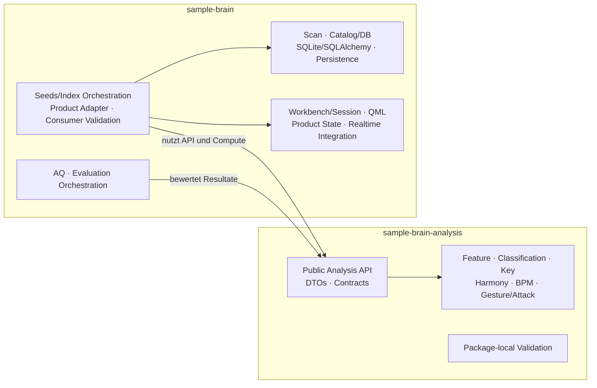

# Ownership Map

- **Purpose:** Die zuständige Repository-Seite für eine Änderung und ihre Nicht-Ownership-Grenzen erkennen.
- **Audience:** Maintainer, Owner und technische Reviewer.
- **Source of truth:** [Analysis Package Boundary](../ANALYSIS_PACKAGE_BOUNDARY_V1.md), [Analysis Consumer Contract](../ANALYSIS_PUBLIC_CONTRACT_V1.md), [Canon Index](../CANON_INDEX.md).
- **Not covered:** API-Symbolliste, DTO-Felder, Algorithmen oder einzelne Persistenzschemas.

## Wenn du nur 30 Sekunden hast

Analysis Compute und seine neutralen Contracts gehören `sample-brain-analysis`. Scan, Datenbank, Persistenz, Product, Workbench und Evaluation gehören `sample-brain`. Der Consumer validiert sein installiertes Paket selbst; package-lokale Validierung liegt beim Paket.

**Harte Grenzen:** Das Analysis-Paket besitzt weder Catalog/DB und Product State noch Workbench, QML, Realtime oder AQ-Orchestration. `sample-brain` besitzt keine zweite Implementierung paket-eigener Algorithmen oder Contracts. Historische `src.*`-Importpfade sind Kompatibilitäts-Aliase, keine zweite Compute-Authority.

Für die genaue Zuordnung von Classification Seeds, Key-Persistenz, Catalog Matching und Consumer-Gates gilt die [Analysis Package Boundary](../ANALYSIS_PACKAGE_BOUNDARY_V1.md). Die [Paket-API](https://github.com/jannekbuengener/sample-brain-analysis/blob/v0.1.1/docs/contracts/analysis-public-api-v1.md) definiert Namen und Resultattypen; der [Consumer Contract](../ANALYSIS_PUBLIC_CONTRACT_V1.md) definiert ihre Verwendung hier. Produkt- und Runtime-Grenzen stehen im [Target Architecture](../TARGET_ARCHITECTURE.md).
