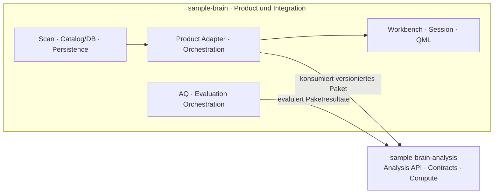
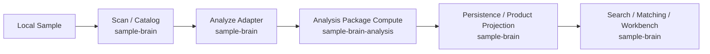

# System Map

- **Purpose:** Die aktuelle Repository-Grenze und den Weg eines Samples durch die Analyse verstehen.
- **Audience:** Maintainer, Owner und technische Reviewer.
- **Source of truth:** [Canon Index](../CANON_INDEX.md), [Target Architecture](../TARGET_ARCHITECTURE.md), [Analysis Package Boundary](../ANALYSIS_PACKAGE_BOUNDARY_V1.md).
- **Not covered:** Modulgraph, Release-Prozess, geplante Repositories oder vollständiger Produktstatus.

Der Pfeil zur Analysis zeigt die Abhängigkeit: `sample-brain` konsumiert das externe Paket. Das Paket ist unabhängig von Catalog, Product und Workbench. Die interne Anordnung der Product-Knoten ist eine Lesehilfe, kein vollständiger Aufrufgraph.

## Wenn du nur 30 Sekunden hast

`sample-brain` findet Samples, hält Catalog und DB, ruft Analysis Compute auf und projiziert Ergebnisse ins Produkt. `sample-brain-analysis` besitzt die neutralen Berechnungen und deren Contracts; Ergebnisse gehen zur Persistence in `sample-brain` zurück.

Die Produktperspektive ist [Edit → Arrangement → later Live](../PRODUCT_WORKFLOW_CANON.md). Arrangement ist ein aktiver Delivery-Bereich; Live ist eine spätere, geparkte Perspektive. Diese Produktfolge ändert die Repository-Grenze im Diagramm nicht.

Details: [Analysis Consumer Contract](../ANALYSIS_PUBLIC_CONTRACT_V1.md), [Product Workflow Canon](../PRODUCT_WORKFLOW_CANON.md) und [Target Architecture](../TARGET_ARCHITECTURE.md).
